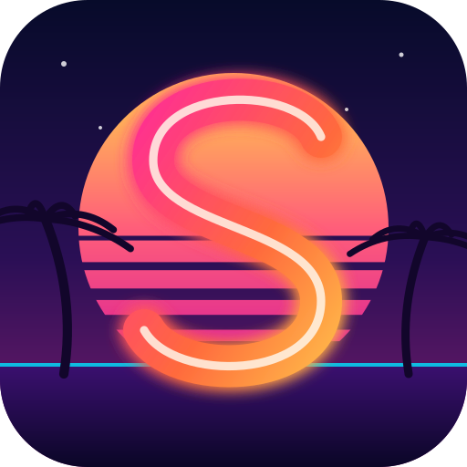
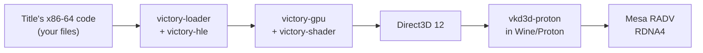

<div align="center">



<br>

[](https://github.com/pablogonz12/Scarlight/actions/workflows/ci.yml)
[](LICENSE)


[](#how-we-work)
[](https://github.com/pablogonz12/Scarlight/stargazers)

**A Linux + AMD RDNA4 (RX 9000) first port. Not playable yet.**

<sub>[What it is](#what-it-is) · [Target](#target) · [Status](#status) · [Requirements](#requirements) · [Build](#build) · [Run](#run) · [How we work](#how-we-work) · [Credits](#credits)</sub>

</div>

## What it is

Scarlight is a **GPL-3.0 port of the console build** of the title to PC, running through
**Wine/Proton + vkd3d-proton + Mesa RADV**. It runs the title's own x86-64 code from files you
supply, answers its console-only calls, and turns its GPU commands and shaders into Direct3D 12.
It is based on [VIctory](https://github.com/Marvisak/VIctory) and
[fxceless's victory-fork](https://github.com/fxceless/victory-fork), with their history and
authors kept. No game files, dumps or screenshots are in this repository.



Crates: [docs/architecture.md](docs/architecture.md).

## Target

| | |
|---|---|
| **First** | Arch-family Linux with an AMD RX 9000 (RDNA4) card |
| **Tested** | RX 9070 XT on CachyOS |
| **May work** | Other RDNA cards and other Linux distributions (not tested here) |
| **Not supported here** | NVIDIA GPUs and native Windows |

For NVIDIA or Windows, use [JMAN730/project-flamingo](https://github.com/JMAN730/project-flamingo)
or [fxceless/victory-fork](https://github.com/fxceless/victory-fork).

## Status

Measured on one machine (RX 9070 XT, Linux), 25 Nov 2026.

> [!IMPORTANT]
> The lit picture comes from the candidate build, tag
> [`keep/scar-candidate-20261125`](https://github.com/pablogonz12/Scarlight/tree/keep/scar-candidate-20261125)
> (on the fxceless base). **It is not merged into `main` yet.** On `main` the world is still mostly
> black, at under 1 fps ([AMD-LINUX.md](AMD-LINUX.md)).

| Area (candidate build) | State |
|---|---|
| Boot, menus, audio, pad | Works |
| World in the prologue | Renders lit, about **2-3 fps** at best; many runs are slower (1-2 fps) and it varies by scene and switches |
| Interiors and shadowed areas | **Known issue:** dark |
| Intro | **Known issue:** frames can show out of order |
| Stability | **Known issue:** occasional freezes with experimental switches; `VICTORY_ASYNC_WRITEBACK=1` has hung the title |
| Playable | **No** |

## Requirements

| | |
|---|---|
| OS / GPU | Arch-family Linux, RX 9070 XT (tested) |
| Wine | **GE-Proton11-14** (tested), running its `wine` binary directly, not the `proton` script |
| Direct3D 12 | **vkd3d-proton master** (or the DLLs shipped in GE-Proton11-14). Stock vkd3d-proton 3.1 crashes at world entry |
| Driver | **Mesa 26.3.1** RADV (tested) |
| RAM | **32 GB or more recommended** (tests ran with about 30 GB usable and little to spare) |
| Build tools | Rust (pinned in `rust-toolchain.toml`) and `cargo-xwin` |
| Game files | **Your own legally obtained copy.** None is included, linked or shared |

The candidate build also needs `dxcompiler.dll` and `dxil.dll`
([DirectXShaderCompiler](https://github.com/microsoft/DirectXShaderCompiler/releases)) and, as a
stop-gap, Microsoft's `d3dcompiler_47.dll` next to the exe. You supply these too.

## Build

```bash
git clone https://github.com/pablogonz12/Scarlight && cd Scarlight
git checkout keep/scar-candidate-20261125   # lit-world candidate; stay on main to contribute
rustup target add x86_64-pc-windows-msvc
cargo install cargo-xwin                    # once
cargo xwin build --release -p victory --target x86_64-pc-windows-msvc
```

The output is a Windows binary that runs under Wine. Add `--features diagnostics` for per-frame
statistics.

## Run

Full setup and a copy-paste play script: **[docs/linux.md](docs/linux.md)**.

| Switch | Effect |
|---|---|
| `VICTORY_NO_WATCHDOG=1` | Turns off the title's watchdog (opt-in hook, one known build). Use it: slow frames can otherwise make the title quit. A real hang then stays a hang |
| `VICTORY_PIPELINE_WAIT_MS=<ms>` | *Candidate build.* Per-frame wait for background pipeline creation, default 500. Lower (e.g. 24) stalls less, but draws are left out until their pipeline is ready |
| `VICTORY_DEPTH_TWINS=0` / `stencil` / `nodepth` | *Candidate build.* On by default. These turn off depth/stencil twin textures entirely or limit which are made; for comparing picture problems |
| `VICTORY_ASYNC_WRITEBACK=1` | **Experimental**, off by default. Writes GPU results back on another thread; has hung the title in our tests |

## How we work

- We **watch the other ports** and forks, measure their fixes on RDNA4 + Linux, and take the ones
  that help, **with credit** and the authors' commits kept ([INTEGRATION.md](INTEGRATION.md)).
- **Every gain goes up as a PR** with its evidence (log lines, shader counts, frame timings).
- Our gains **also go to [project-flamingo](https://github.com/JMAN730/project-flamingo) as PRs**.
  Fixes that fit [VIctory](https://github.com/Marvisak/VIctory) should go there too.
- PRs here target `main`; see [CONTRIBUTING.md](CONTRIBUTING.md). A test report from another RDNA
  card is as useful as a patch.
- Docs, commits and PRs never name the title or its developer. Never commit game files
  ([asset policy](docs/asset-policy.md)).

## Credits

- [Marvisak/VIctory](https://github.com/Marvisak/VIctory): the project this is built on (Marvis and contributors).
- [fxceless/victory-fork](https://github.com/fxceless/victory-fork) (fxceless / hyphennn): the base of the lit-world candidate.
- [uiliannn/VItoriaBr](https://github.com/uiliannn/VItoriaBr) (uiliannn): a fork we follow and learn from.
- **ErRusso**: runtime HLSL through DXC. **ZazaJr24**: configurable pipeline waits.
  **ruvenesh**: the opt-in watchdog hook (VIctory #454).

Authors of commits carried in the candidate build:
9hvn9yt2vk-netizen, Abdellah K., Advait Palve, AlanQiang0418, alessiodeia, Andrea Casale,
AnoHunted, artor410, BaggyALPHA, Carlos Sant'Anna, cxchhh (cxccxc), Dathinel, Duff, EatCodeSleep2,
Enzo Souza Duarte, errusso, Exorion, fever308, FIocker, fuzeofficial, fxceless, Henrique Bueno,
hophaver, ifBars, ismailchaka1, itsRevela, Jeremy Goldberg, julio, KoLolX3, lameloball2813-ui,
LaunchDoesntCode, localshotgun, lordon1a, Louis Faust, LUIS LARIOS, Luiz Neves,
Luiz Otavio Mello de Campos, Lyrnc, Manuel Pérez, Maraco91, marquezini, Marvis, meower, Nostyxx,
oddiums, pablogonz12 (Pablo Gonzalez), Pedro Fortunato, quaternion, r4tedx (r4.), raffclar,
Saitken91, spacede, tedin7, TG0000, undeadhuman37, Vanthys, wrothgaril, Yaekai, ZazaJr24.
Some commits were also authored by AI coding tools (Claude, Codex). More per-PR credit:
[INTEGRATION.md](INTEGRATION.md). Missing or misnamed? Open an issue.

## License

GPL-3.0-or-later; see [LICENSE](LICENSE).
