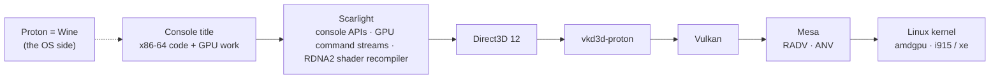

<div align="center">


<br>

[](https://github.com/pablogonz12/Scarlight/actions/workflows/ci.yml)
[](https://github.com/pablogonz12/Scarlight/actions/workflows/linux.yml)
[](LICENSE)
[](https://github.com/pablogonz12/Scarlight/commits/main)
[](https://docs.mesa3d.org/)
[](docs/hardware.md)
[](https://www.vulkan.org/)
[](https://github.com/pablogonz12/Scarlight/stargazers)

# Scarlight: an Xbox Series compatibility tool for Steam on Linux

**Built on Proton, tuned for Mesa.** Install it into Steam's compatibility tools, pick
**Scarlight (Xbox Series)** under a title's *Properties → Compatibility*, and press Play.<br>
Scarlight answers the console APIs a title calls, decodes its GPU command streams and recompiles its
RDNA2 shaders; Proton's Wine carries the operating-system side and vkd3d-proton turns the graphics
into Vulkan, on Mesa's open drivers. Written in Rust, GPL-3.0, and it contains no game files.

<sub>[Status](#status) · [Install](#install) · [How it works](#how-it-works) · [Roadmap](#roadmap) ·
[Help wanted](#help-wanted) · [Credits](#credits) · [Licence](#licence)</sub>

</div>

> **25 November 2026 — Scarlight is now a Steam compatibility tool.** Until today it was a binary you
> started by hand; from today it is one install, one entry in Steam's Compatibility list, and Play.
> The code is the same code; the development setup of the previous line is preserved on branch
> `legacy/amd-hub`. Why, and what moved where: [ANNOUNCEMENT.md](https://github.com/pablogonz12/Scarlight/blob/docs/announcement-steam/ANNOUNCEMENT.md).

## Status

Early, and honest about it: **not playable yet.** One title has been tried, on one machine, and its
world renders only partly — lit and textured in places, much of the scene dark, at a few frames per
second. The work now is picture and speed, in that order.

Measured 25 Nov 2026 on **RX 9070 XT (RDNA4) · Mesa 26.3.1 RADV** (Vulkan 1.4) · CachyOS ·
GE-Proton11-14 · vkd3d-proton · 30 GB RAM. Diagnostics builds.

| Area | State |
|---|---|
| Boot, menus, audio, gamepad | Work; menus at 30 fps |
| World | Renders partly: lit and textured in places, much of the scene dark |
| Frame rate | **1.5–3 fps** at one fixed scene (median per build) |
| Shaders | **751 / 751** world programs translate; 749 / 751 build a real RADV pipeline |
| Time to the world | 133–218 s |
| Stability | Some builds hang at boot or at world entry |
| **Playable** | **No** |

No other GPU and no other title have been tried, so nothing here is a promise about your machine.

## Install

Three steps.

1. **Install the tool into Steam.** Download `Scarlight-<version>.tar.gz` from
   [Releases](https://github.com/pablogonz12/Scarlight/releases) and extract it into Steam's
   compatibility tools folder:

   ```bash
   tar -xzf Scarlight-*.tar.gz -C ~/.local/share/Steam/compatibilitytools.d/
   ```

   Flatpak Steam: `~/.var/app/com.valvesoftware.Steam/data/Steam/compatibilitytools.d/`.
   From a source checkout instead, `tools/steam-compat/install.sh` does the same for you.
2. **Restart Steam.**
3. **Pick it for the title.** *Library → right-click the title → Properties → Compatibility →* tick
   **Force the use of a specific Steam Play compatibility tool** and choose **Scarlight (Xbox Series)**.
   Press Play.

You need a Proton of your own (GE-Proton or Valve's): the tool runs on its Wine and names it in one
line of `scarlight.conf`. The graphics DLLs that can be redistributed are in the tarball; Microsoft's
`d3dcompiler_47.dll` is not, and is optional. Requirements (a Mesa Vulkan driver, Vulkan 1.3+) and
every conf option, log location, uninstall step and troubleshooting entry:
**[docs/steam.md](docs/steam.md)**.

Scarlight ships no game data. It runs a title's own files from a copy you legally own.

## How it works



- **Proton does the operating-system side.** The title's file, thread, memory and window calls are
  Wine's job, through the Proton you already installed. We neither ship nor fork Proton.
- **Scarlight does the console side.** It answers the console system APIs the title calls, decodes
  its GPU command streams, and recompiles its RDNA2 shaders and pipelines for the host.
- **vkd3d-proton and Mesa draw it.** The re-emitted Direct3D 12 goes through vkd3d-proton into
  Vulkan, and Mesa's RADV (AMD) or ANV (Intel) submits it to the kernel. Mesa is open source, so the
  driver is ours to read, tune and fix — that is the point of building for it.

Design notes: [docs/architecture.md](docs/architecture.md).

## Roadmap

| Stage | Goal |
|---|---|
| **Now** | A complete picture on the fixed scene: every world pipeline pre-built, dark areas lit, faces and walls drawn |
| **Next** | Frame rate: remove the per-frame copies and stalls, cache keys that survive a rebuild |
| **Later** | Talk to Vulkan directly — zero-copy title memory, then SPIR-V straight from the console's shaders |

No dates; these are goals, not results.

## Help wanted

The missing pieces are specific, and **people who know Wine, Proton or Mesa are the most useful of
all** — this project spends its time where those three meet:

- **Wine / Proton:** the OS-side behaviour a console title expects (threads, timing, file layout),
  and how a compatibility tool should hand work to a Proton build.
- **Mesa (RADV, ANV):** what a pipeline that builds offline but stalls on first use is telling us,
  shader cache behaviour, and driver-side cost of the command stream we re-emit.
- **vkd3d-proton:** the Direct3D 12 features and hazards a console-shaped workload leans on.
- **Rust, and the formats:** command-stream decoding, the shader translator, and the RDNA2 ISA.
- **Owners of another Mesa GPU** (RDNA1-3, Vega, Arc, Xe): a run on your card is as useful as a patch.

Use the [test report](https://github.com/pablogonz12/Scarlight/issues/new?template=test-report.yml) or
[bug report](https://github.com/pablogonz12/Scarlight/issues/new?template=bug-report.yml) forms with
your GPU, driver and Mesa version, kernel, distribution, Proton build, and the last ~50 lines of
`scarlight.log`. Text and logs only: no game files, no screenshots. Pull requests are welcome;
[CONTRIBUTING.md](CONTRIBUTING.md) has the build, test and asset rules, and
[Discussions](https://github.com/pablogonz12/Scarlight/discussions) is where questions go.

## Credits

Scarlight is a port of the project named in [CREDITS.md](CREDITS.md) (GPL-3.0), whose history and
authorship this tree keeps; every contributor is named there, along with the third-party licences a
release ships.

## Licence

GPL-3.0-or-later; see [LICENSE](LICENSE).

Not affiliated with or endorsed by Microsoft. Xbox and Xbox Series are trademarks of Microsoft.

<sub>Development lab of the previous line (offline shader checks, GPU run queue, performance ledger,
worker pipeline) lives on branch
[`legacy/amd-hub`](https://github.com/pablogonz12/Scarlight/tree/legacy/amd-hub), with tag
`legacy-amd-hub-2026-11-25`. Nothing is deleted; `main` continues from the same commit.</sub>
