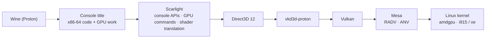

<div align="center">


<br>

[](https://github.com/pablogonz12/Scarlight/actions/workflows/ci.yml)
[](LICENSE)
[](https://github.com/pablogonz12/Scarlight/commits/main)
[](https://docs.mesa3d.org/)
[](https://docs.mesa3d.org/drivers.html)
[](https://www.vulkan.org/)
[](https://github.com/pablogonz12/Scarlight/stargazers)

# Scarlight: a Linux-first console translation layer, built and tuned for Mesa

**It runs the console build on Linux through Proton — Wine and vkd3d-proton — on Mesa's open Vulkan drivers.<br>RADV (AMD) is the reference, ANV (Intel) is next, NVK (NVIDIA) after that: every AMD and Intel GPU Mesa supports is the target, on any Linux with a recent kernel and Mesa.<br>Mesa is open source, so the driver is ours to read, tune and fix, and every part of this project is developed and measured on that stack.**

<sub>[What it is](#what-it-is) · [Why Mesa](#why-mesa) · [Status](#status) · [Hardware](#hardware) · [Requirements](#requirements) · [Quick start](#quick-start) · [How it works](#how-it-works) · [Roadmap](#roadmap) · [Contribute](#contribute) · [Credits](#credits) · [Licence](#licence)</sub>

</div>

## What it is

Scarlight runs the console build on Linux. It loads the title's own x86-64 code from files you
supply, answers the console-only calls that code makes, decodes its GPU command stream, and
recompiles its shaders. Today the result goes out as Direct3D 12, which vkd3d-proton turns into
Vulkan for Mesa's driver; Wine, through Proton, hosts the Windows ABI underneath. It is written in
Rust, licensed GPL-3.0, and contains no game files: bringing your own copy is the only way to run it.

That stack is not one option among several, it is the one this project is built for: the pipeline
cache and driver switches are tuned with Mesa's own tooling, GPU-side losses are chased into
Wine- and vkd3d-proton-on-RADV behaviour rather than around it, and shader and pipeline checks run
across GPU families before anything is measured on a card.

It is early. The world renders, lit and textured, at a few frames per second on one card, and the
work now is picture and speed, in that order. The point of the project is not one card: it is that
the same build should run wherever Mesa runs.

## Why Mesa

The stack ends in Mesa, and the Vulkan driver is the layer where a project like this either gets
answers or gets stuck. Mesa is open source, so a driver bug can be found and fixed instead of worked
around:

- **read the driver code** that refuses a pipeline, drops a draw or reorders a barrier, instead of
  guessing against a closed binary;
- **tune with its own tools** — `RADV_PERFTEST`, `RADV_DEBUG`, `ACO_DEBUG`, RADV and ANV driconf
  keys, the pipeline cache, and `VK_KHR_pipeline_executable_properties` statistics that say why one
  pipeline takes longer to compile than the next;
- **run a patched Mesa** built from source beside the system one through `VK_ICD_FILENAMES`, to test
  a fix without touching the install;
- **send the fix upstream**, so it lands for every Mesa user rather than living in this repository.

That is why the project is built for Mesa and not for one GPU. Work that is specific to a driver or
a card sits behind a Vulkan driver-id and device-id check, so every other Mesa setup keeps a working
path. If Mesa runs it, Scarlight should run on it.

The direction is to meet Mesa directly: a native Vulkan backend that drops the Direct3D 12 layer, and
possibly a native Linux host that drops Wine. Both are goals, not features — see [Roadmap](#roadmap).

## Status

Measured on one machine, 25 Nov 2026: **RX 9070 XT (RDNA4) · Mesa 26.3.1 RADV** (Vulkan 1.4) ·
CachyOS, kernel 7.3.6 · GE-Proton11-14 · vkd3d-proton master · 30 GB RAM. Diagnostics builds. No
other GPU has been tried.

| Area | State |
|---|---|
| Boot, menus, audio, gamepad | Work; menus at 30 fps |
| World, fixed test scene | Lit and textured; **1.45-1.6 fps** in current builds, **up to 3.0 fps** in one earlier build (one run each) |
| Time to the world | 133-218 s |
| Shader translation | **751 / 751** world programs translate offline |
| Picture | Faces and close-up character detail missing; walls missing in some builds; shadowed areas dark |
| Stability | Some builds hang at boot or at world entry; async write-back is experimental |
| **Playable** | **No** |

The scene figure is the median of the first idle view in the world, the only frame rate we compare
between builds. The same build varies by about 10 % between runs here, so a single run proves
little, and the fastest run above is not the newest build.

## Hardware

| **Tested** | **Expected** | **Unknown** |
|---|---|---|
| **RX 9070 XT (RDNA4) · RADV**<br>The only hardware this has been run on: every number on this page comes from it | **RDNA3, RDNA2, RDNA1 (RX 7000 / 6000 / 5000) · RADV**<br>Same driver, older generations. Not yet checked.<br><br>**Arc A-series, Arc B-series, Xe2 · ANV**<br>A second open driver with the same Vulkan 1.3 baseline. Not yet checked. | **GeForce · NVK**<br>Planned after ANV. Not yet checked.<br><br>**Intel Gen9 and older integrated · ANV**, **GCN/Polaris and older · RADV**, **AMD APUs**, any Mesa older than ours<br>Not yet checked. |

A row moves to "Tested" with a run, not an opinion: one report with the details below is enough. If
your card is in the middle or right column, [tell us what it does](#help-us-test).

Not supported: native Windows and NVIDIA's proprietary driver.

## Requirements

| Need | Minimum | Tested here |
|---|---|---|
| **Linux kernel** | recent enough to drive your card (`amdgpu`, `i915`/`xe`); a hard minimum **to be confirmed** from test reports | 7.3.6 |
| **Mesa** | a Mesa whose RADV/ANV/NVK exposes **Vulkan 1.3**; the oldest working version is **to be confirmed** — we test on one version only | 26.3.1 |
| **Vulkan** | **1.3**, which is what vkd3d-proton needs | 1.4.363, RADV `GFX1201` |
| **Wine** | a Proton or GE-Proton build, called through its own `wine` binary, not the `proton` script | GE-Proton11-14 |
| **Direct3D 12** | [vkd3d-proton](https://github.com/HansKristian-Work/vkd3d-proton) **master** — release 3.1 crashed at world entry | master |
| **RAM** | 32 GB recommended | about 30 GB usable |

You also need, outside this repository: your own legally obtained copy of the title's files, 64-bit
`dxcompiler.dll` and `dxil.dll` from
[DirectXShaderCompiler](https://github.com/microsoft/DirectXShaderCompiler/releases), and — as a
stop-gap — Microsoft's 64-bit `d3dcompiler_47.dll` from software you are licensed to use, because
Wine's built-in one rejects some runtime shaders.

Check the stack before you build: `vulkaninfo --summary` should name `radv`, `anv` or `nvk`, with an
`apiVersion` of at least 1.3.

## Quick start

Arch-family Linux, current Mesa. On other distributions install the equivalent packages (Mesa's
Vulkan driver: `vulkan-radeon`, `vulkan-intel` or `mesa-vulkan-drivers`) and the same build tools.

```bash
sudo pacman -S --needed mesa vulkan-radeon rustup git clang lld llvm   # vulkan-intel on Intel
git clone https://github.com/pablogonz12/Scarlight && cd Scarlight
rustup toolchain install                                  # version pinned in rust-toolchain.toml
cargo install cargo-xwin                                  # once
cargo xwin build --release -p victory --features diagnostics --target x86_64-pc-windows-msvc
```

That produces a Windows binary; it runs here under Wine. Tags in the repository mark builds that
were measured on the scene above — `main` moves between them, so a build of `main` can be ahead or
behind the latest number.

Copy the DLLs next to the exe and start it with GE-Proton's `wine` (not the `proton` script). Edit
the first five paths:

```bash
GE="$HOME/.local/share/Steam/compatibilitytools.d/GE-Proton11-14"   # your folder name
VKD3D="$HOME/dlls/vkd3d-proton-master"   # d3d12.dll, d3d12core.dll (x64)
DXC="$HOME/dlls/dxc"                     # dxcompiler.dll, dxil.dll (x64)
D3DC="$HOME/dlls/d3dcompiler_47.dll"     # x64
GAME="$HOME/victory-data/game/<the title's exe>"
OUT="$PWD/target/x86_64-pc-windows-msvc/release"

cp "$VKD3D"/d3d12.dll "$VKD3D"/d3d12core.dll "$DXC"/dxcompiler.dll "$DXC"/dxil.dll "$D3DC" "$OUT"/
cp "$GE"/files/lib/wine/dxvk/x86_64-windows/dxgi.dll "$OUT"/

WINEPREFIX="$HOME/.local/share/scarlight-prefix" \
WINEDLLOVERRIDES="d3d12,d3d12core,dxgi,d3d11,d3d10core,d3dcompiler_47=n,b" \
VKD3D_CONFIG=ignore_shared_fence VICTORY_LOG=info \
"$GE/files/bin/wine" "$OUT/victory.exe" run "$GAME" --execute
```

A play script, the keyboard-as-gamepad map and troubleshooting are in **[docs/linux.md](docs/linux.md)**.
The sequence above has not been run as written on a fresh prefix; the runs behind the numbers use
test scripts. If it fails, open an issue with the last 50 lines of the log.

### Switches

| Switch | Effect |
|---|---|
| `VICTORY_NO_WATCHDOG=1` | Turns off the title's watchdog (opt-in hook, newer builds only). Use it: slow frames can make the title quit by itself |
| `VICTORY_PIPELINE_WAIT_MS=<ms>` | Per-frame wait for background pipeline creation, default 500. A lower wait stalls less, but draws are left out until their pipeline is ready |
| `VICTORY_DEPTH_TWINS=0` / `stencil` / `nodepth` | Depth and stencil twin textures off or limited, for comparing picture problems |
| `VICTORY_ASYNC_WRITEBACK=1` | **Experimental**, off by default; has hung the title in our tests |

## How it works



The title's x86-64 code runs under Wine, started through Proton. Its console kernel calls are
answered in user space by a loader and a high-level emulation layer; its GPU command stream is
decoded and re-emitted as Direct3D 12, with the console's shaders recompiled and pipelines rebuilt
for the host. vkd3d-proton turns those calls into Vulkan, and Mesa's driver is what finally submits
them to the kernel. Four translations between the console's code and the GPU, and most of a measured
frame is spent before the GPU draws at all: the title waits on pipelines that are still being
compiled (457 ms of a 602 ms median frame in a diagnostics run).

Crates, call flow and the memory model: [docs/architecture.md](docs/architecture.md).

## Roadmap

| Stage | Goal |
|---|---|
| **1. Now: picture, pre-built pipelines, Mesa tuning** | On the fixed scene: faces, full-detail characters up close, walls, no black flashes, colour as the reference. Every world program and pipeline built before it is needed, like the console does, with the slow ones quarantined instead of stalling a frame; tuned with Mesa's own switches, statistics and pipeline cache. Target about 2.5-3 fps and the world in under 90 s |
| **2. A native Vulkan backend** | Emit Vulkan and SPIR-V from Scarlight itself, so Mesa receives the console's work directly instead of through Direct3D 12 and vkd3d-proton: one translation less, and driver behaviour we can debug end to end |
| **3. Possibly: a native Linux host** | Run the console code on Linux without Wine: the last layer gone, a Linux program end to end |

Alongside those: stop staging the title's memory through copies where the driver can import host
memory directly, and un-tile the console's textures on the GPU with a compute pass rather than on the
CPU. Every step keeps every Mesa GPU a supported path — a first confirmed run on ANV, then NVK, is
part of the work.

These are goals, not results. Picture comes before speed throughout: a speed change that costs
picture quality is not kept.

## Contribute

**A test report from another Mesa GPU is as useful as a patch.** AMD (RDNA1-3, Vega), Intel (Arc,
Xe) and NVIDIA (NVK, later) are all wanted.

What makes a useful report, in **text and logs only** — never screenshots, game files or dumps of
the title's data:

1. GPU, driver (`radv`, `anv`, `nvk`), Mesa version and where it came from (distribution,
   `mesa-git`, a local build).
2. Kernel version, distribution, Wayland or X11.
3. The Scarlight commit you built, and your GE-Proton and vkd3d-proton versions.
4. Did it reach the world? Time to the world, and the frame lines if your run prints them.
5. What looked wrong: missing walls or faces, black or flat-lit areas, wrong colours, out-of-order
   intro frames.
6. The log with `VICTORY_LOG=info`: `does not translate`, dropped or "being made" pipelines,
   device-removed and crash lines.

Issue forms ask for exactly that. Pull requests target `main` and go in after CI and review:
[CONTRIBUTING.md](CONTRIBUTING.md) has the build, test, naming and asset rules. Docs, commits and
PRs never name the title or its developer; game files are never committed
([asset policy](docs/asset-policy.md)). Parts of the project, this page included, are written with
AI coding tools.

If you want a Linux + Mesa port to keep moving, star the repository and tell us what your card does.

## Credits

Built on **VIctory** (GPL-3.0) and work from its community — every contributor is named in
[CREDITS.md](CREDITS.md).

## Licence

GPL-3.0-or-later; see [LICENSE](LICENSE).
