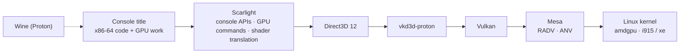

<div align="center">


<br>

[](https://github.com/pablogonz12/Scarlight/actions/workflows/ci.yml)
[](LICENSE)
[](https://github.com/pablogonz12/Scarlight/commits/main)
[](https://docs.mesa3d.org/)
[](docs/hardware.md)
[](https://www.vulkan.org/)
[](https://github.com/pablogonz12/Scarlight/stargazers)

# Scarlight: an Xbox Series compatibility layer for Linux, built and tuned for Mesa

**It implements the console system APIs a title calls, decodes its GPU command streams and recompiles its RDNA2 shaders, and runs the result through Proton — Wine and vkd3d-proton — on Mesa's open Vulkan drivers.<br>RADV (AMD) is the reference and ANV (Intel) is next. Mesa is open source, so the driver is ours to read, tune and fix, and every part of this project is developed and measured on that stack.**

<sub>[What it is](#what-it-is) · [Status](#status) · [Progress](#progress) · [Hardware](#hardware) · [Requirements](#requirements) · [Quick start](#quick-start) · [How it works](#how-it-works) · [Roadmap](#roadmap) · [Launcher](#launcher) · [Help us test](#help-us-test) · [Contribute](#contribute) · [Who is behind this](#who-is-behind-this) · [Credits](#credits) · [Licence](#licence)</sub>

</div>

## What it is

Scarlight is a compatibility layer for titles built against the Xbox Series GDK. It loads a title's
own x86-64 code from files you supply, answers the console system API calls that code makes, decodes
its GPU command stream and recompiles its RDNA2 shaders, and rebuilds its pipelines for the host. It is
written in Rust, GPL-3.0, and contains no game files: bringing your own legally obtained copies is
the only way to run it.

Today it runs through Proton, built and tuned for Mesa. As far as we know it is among the
furthest-along Xbox Series compatibility efforts running under Proton; we have not compared every
project, and the scope here is deliberately different — Mesa is the target platform, not one card
or one proprietary driver.

It is early. It has been built and run with one title so far, and that title's world renders lit and
textured at a few frames per second on one card; the work now is picture and speed.

## Status

Measured on one machine, 25 Nov 2026: **RX 9070 XT (RDNA4) · Mesa 26.3.1 RADV** (Vulkan 1.4) ·
CachyOS, kernel 7.3.6 · GE-Proton11-14 · vkd3d-proton master · 30 GB RAM. Diagnostics builds.
Tested so far with **one title**; reports from other content are welcome, and no other GPU has been
tried.

| Area | State |
|---|---|
| Boot, menus, audio, gamepad | Work; menus at 30 fps |
| World, fixed test scene | Lit and textured. **3.0 fps** on tag `keep/best-fx-578d459c` (one run, Microsoft's `d3dcompiler_47` beside the exe); **1.45-1.7 fps** on nine builds of the current base (one run each) |
| Time to the world | 133-218 s (three builds) |
| Shaders | **751 / 751** world programs of the test title translate, and **749 / 751** build a real RADV pipeline |
| Faces | **Some characters' faces still fail to render** (regressed again on 25 Nov, under investigation) |
| Picture | Close-up character detail and walls missing in some builds; shadowed areas dark |
| Stability | Some builds hang at boot or at world entry; async write-back is experimental |
| **Playable** | **No** |

The frame rate is the median at one fixed scene, the only figure compared between builds; the method
is in [docs/testing.md](docs/testing.md).

## Progress

Each row is a share of a set that was **counted on this machine** — an import table, a shader archive,
a frame of recorded work — so the bars are measurements, not estimates. 100 % in every row is the
target, not a promise: correctness is checked by runs. The System APIs row is the one to read twice:
every import resolves, but only 15 % of them are code this project wrote — the rest is Wine (Proton)
doing its job, and the title's own libraries. Per-row sources, the ISA and pipeline detail, and what
each number means: [docs/PROGRESS.md](docs/PROGRESS.md).

| Area | Progress | Detail | Where |
|---|---|---|---|
| System APIs (HLE) | ████████████ 100 % resolved (0 missing) | ██░░░░░░░░░░ 15 % own HLE | [detail](docs/PROGRESS.md#system-apis-hle) |
| Shaders | ███████████░ 99 % | ███████████░ 99 % real RADV pipeline | [detail](docs/PROGRESS.md#shaders) |
| GPU command stream | ███████████░ 92 % | ███████████░ 92 % verified | [detail](docs/PROGRESS.md#gpu-command-stream) |
| Pipelines | ████████░░░░ 69 % | ███████████░ 99 % built offline | [detail](docs/PROGRESS.md#pipelines) |
| Features | status words | 2 of 10 shown | [detail](docs/PROGRESS.md#features) |
| Mesa reach (compiled offline, not run) | ██████████░░ 80 % | compiled only, not run | [detail](docs/PROGRESS.md#mesa-reach) |
| Performance | █░░░░░░░░░░░ 5 % | █░░░░░░░░░░░ 5 % of 30 fps | [detail](docs/PROGRESS.md#performance) |

Measured on 25 Nov 2026, build 5fca579b, RX 9070 XT (RDNA4) / Mesa 26.3.1 RADV. The gaps are the
honest ones: 88 of 587 imports are our own HLE, the whole-archive shaders have translation but no
validated pipeline column yet, and speed is a twentieth of the console's 30 fps. The world set does
more than translate, though: **749 of 751** build a real RADV pipeline, and through Mesa's noop
drm-shims the same set compiles for every AMD generation up to ours (Vega 669/751, no mesh shaders)
and on Intel ANV for Arc B **751/751**, Arc A 750/751 and Xe-LPG 750/751; the single Intel miss is
the stub's own query gap, not a compiler error. Only RDNA4 has actually been run. Per-family table:
[docs/hardware.md](docs/hardware.md#compile-check-per-family). Regenerate with `tools/progress/collect.sh`
and `tools/progress/render.py`.

## Hardware

| **Tested** | **Expected** | **Unknown** |
|---|---|---|
| **RX 9070 XT (RDNA4) · RADV**<br>Every number on this page comes from this one card | **RDNA1-3 (RX 5000-7000), Vega · RADV**<br>World pipelines compile offline for all four (Vega 669/751, no mesh); not yet run<br><br>**Arc A/B-series, Xe2 · ANV**<br>Not yet checked | **Older Intel, Polaris and older, AMD APUs**<br>Any Mesa older than ours<br>Not yet checked |

Full table, what "Expected" means and how a card moves: [docs/hardware.md](docs/hardware.md). The
world set also compiles for every family in the two right-hand columns through Mesa's noop drm-shim,
RADV and ANV alike; that result, per family, is the
[compile check](docs/hardware.md#compile-check-per-family). Native Windows and NVIDIA's proprietary
driver are unsupported; NVK is a roadmap item, not a target yet.

## Requirements

| Need | Minimum | Tested here |
|---|---|---|
| **Linux kernel** | recent enough to drive your card (`amdgpu`, `i915`/`xe`); a hard minimum **to be confirmed** | 7.3.6 |
| **Mesa** | a Mesa whose RADV or ANV driver exposes **Vulkan 1.3**; the oldest working version is **to be confirmed** | 26.3.1 |
| **Vulkan** | **1.3**, which is what vkd3d-proton needs | 1.4.363 |
| **Wine** | a Proton or GE-Proton build, called through its own `wine` binary | GE-Proton11-14 |
| **Direct3D 12** | [vkd3d-proton](https://github.com/HansKristian-Work/vkd3d-proton) **master** — release 3.1 crashed at world entry | master |
| **RAM** | 32 GB recommended | about 30 GB usable |

You also supply, outside this repository: your own legally obtained copies of a title's files, 64-bit
`dxcompiler.dll` and `dxil.dll`
([DirectXShaderCompiler](https://github.com/microsoft/DirectXShaderCompiler/releases)), and — as a
stop-gap — Microsoft's `d3dcompiler_47.dll`: Wine's built-in one rejects some runtime shaders.

## Quick start

Arch-family Linux, current Mesa. On other distributions install the equivalent packages (Mesa's
Vulkan driver: `vulkan-radeon`, `vulkan-intel` or `mesa-vulkan-drivers`) and the same build tools.

```bash
sudo pacman -S --needed mesa vulkan-radeon vulkan-tools rustup git clang lld llvm   # vulkan-intel on Intel
git clone https://github.com/pablogonz12/Scarlight && cd Scarlight
rustup toolchain install 1.98.1                           # the version pinned in rust-toolchain.toml
cargo install cargo-xwin                                  # once
cargo xwin build --release -p victory --features diagnostics --target x86_64-pc-windows-msvc
```

Wine needs a graphical session (`DISPLAY` set; on a headless machine, run it under Xwayland or Xvfb),
and the first `cargo xwin build` downloads Microsoft's CRT and Windows headers, so it needs network
once.

That produces a Windows binary; it runs here under Wine. Tags mark builds measured on the scene above,
so a build of `main` can be ahead or behind the latest number. Copy the DLLs next to the exe and start
it with GE-Proton's `wine` (not the `proton` script); edit the first five paths:

```bash
GE="$HOME/.local/share/Steam/compatibilitytools.d/GE-Proton11-14-x86_64"   # ls this folder: it usually ends in -x86_64
VKD3D="$HOME/dlls/vkd3d-proton-master"   # d3d12.dll, d3d12core.dll (x64)
DXC="$HOME/dlls/dxc"                     # dxcompiler.dll, dxil.dll (x64)
D3DC="$HOME/dlls/d3dcompiler_47.dll"     # x64
GAME="$HOME/victory-data/game/<the title's exe>"
OUT="$PWD/target/x86_64-pc-windows-msvc/release"

cp "$VKD3D"/d3d12.dll "$VKD3D"/d3d12core.dll "$DXC"/dxcompiler.dll "$DXC"/dxil.dll "$D3DC" "$OUT"/
cp "$GE"/files/lib/wine/dxvk/x86_64-windows/dxgi.dll "$OUT"/

WINEPREFIX="$HOME/.local/share/scarlight-prefix" \
WINEDLLOVERRIDES="d3d12,d3d12core,dxgi,d3d11,d3d10core,d3dcompiler_47=n,b" \
VKD3D_CONFIG=ignore_shared_fence VICTORY_LOG=info \
"$GE/files/bin/wine" "$OUT/victory.exe" run "$GAME" --execute
```

Check the stack first: `vulkaninfo --summary` should show `driverName` `radv`, `Intel open-source Mesa
driver` (ANV) or `nvk`, with an `apiVersion` of at least 1.3. The first run creates the Wine prefix by
itself, about 30 s. Play script, keyboard-as-gamepad map, switches and troubleshooting are in
**[docs/linux.md](docs/linux.md)**.

The build and the bind-only part above were run as written on a fresh clone and an empty prefix: the
load prints `missing=0` for the title and its DLLs, and without `--execute` it only lists what it would
load. A full in-game launch on a fresh prefix is still being verified, so treat the numbers above as
coming from our test machines. If it fails, open an issue with the last 50 lines of the log.

## How it works



The title's code runs under Wine, started through Proton. Its console kernel calls are answered in
user space; its GPU commands are re-emitted as Direct3D 12, with the console's shaders recompiled and
pipelines rebuilt for the host. vkd3d-proton turns those calls into Vulkan, and Mesa submits them to
the kernel. Four translations between the console's code and the GPU, and most of a measured frame is
spent before the GPU draws at all: the title waits on pipelines that are still being compiled (457 ms
of a 602 ms median frame). Crates and call flow: [docs/architecture.md](docs/architecture.md).

## Roadmap

| Stage | Goal |
|---|---|
| **1. Now** | Picture parity on the fixed scene; every world pipeline pre-built like the console; cache keys that survive a rebuild; Mesa cache sizing; fewer copies per frame |
| **2. Next** | A native Vulkan backend: copies and memory on Vulkan, then zero-copy title memory through Mesa's host-memory import, then SPIR-V straight from the console's shaders |
| **Idea, not planned** | A native Linux host without Wine: most of the title's imports are the C/C++ runtime Wine provides today |

No dates, and targets are goals rather than results. Each stage's measured motivation, and the
long-term idea, are in [docs/ROADMAP.md](docs/ROADMAP.md).

## Launcher

**Coming in the next release.** A `scarlight` launcher that puts the whole stack in one place:

- a **system check** before the first run: GPU, Mesa version, Vulkan, Proton build, and which parts
  of the stack are missing;
- **presets**: Play, Performance, Picture debug, and Developer (skip intros, start at the test
  scene);
- a **ray-tracing toggle** where the driver and build support it, the **Mesa options** that matter
  here in one panel, and a **backend choice**: Proton today, native Vulkan when it exists.

It lives in `tools/scarlight-launcher/` and lands in a separate pull request; until then,
[docs/linux.md](docs/linux.md) has the manual setup.

<a id="help-us-test"></a>

## Help us test

**A run on another Mesa GPU is as useful as a patch.** AMD (RDNA1-3, Vega) and Intel (Arc, Xe) are
both wanted; only an RX 9070 XT, with one title, has been tried so far. Send the GPU and driver, the
Mesa version (`driverName`, `driverVersion`, `apiVersion`) and where it came from, kernel,
distribution and session, Proton build, vkd3d-proton version, the commit you built, how far it got
with the frame lines, what looked wrong, and the last ~50 lines of the log — text and logs only.

Use the [test report form](https://github.com/pablogonz12/Scarlight/issues/new?template=test-report.yml)
or the [bug report form](https://github.com/pablogonz12/Scarlight/issues/new?template=bug-report.yml);
[docs/testing.md](docs/testing.md) explains what each number means. If Scarlight breaks on your card
that is our bug, and if the fault is in the driver we take it to Mesa.

## Contribute

Pull requests target `main` and go in after CI and review. [CONTRIBUTING.md](CONTRIBUTING.md) has the
build, test, naming and asset rules, and says which checks to run; [good first
issues](https://github.com/pablogonz12/Scarlight/labels/good%20first%20issue) are written so a
newcomer can finish one without guessing. Questions go to
[Discussions](https://github.com/pablogonz12/Scarlight/discussions), and everyone here follows the
[code of conduct](CODE_OF_CONDUCT.md). Docs, commits and PRs never name the title or its developer; no
game files, screenshots or dumps are ever committed ([asset policy](docs/asset-policy.md)). Parts of
the project, this page included, are written with AI coding tools. If you want a Linux-first project
to keep moving, star the repository and tell us what your card does.

## Who is behind this

Scarlight is currently a one-person project. I write it and test it on one machine — the RX 9070 XT
above — and I lean heavily on AI coding assistants for the code. Nothing goes in on trust: every
change is checked by the test suite, an offline shader check of the whole 751-program world set, and
runs on real hardware, with the picture looked at before the frame rate. I also work on mali-open, a
from-scratch open-source Vulkan driver for Arm Mali GPUs that uses Mesa's compiler as a library.

I cannot cover this alone, and the missing pieces are specific: people who know Mesa (RADV or ANV),
Vulkan, vkd3d-proton, Wine or Rust, and people who own another Mesa GPU and can say what it does.
Open an issue, send a test report, or take a roadmap item.

## Credits

Built on the project named in [CREDITS.md](CREDITS.md) (GPL-3.0), whose history and authorship this
tree keeps, plus work from its community — every contributor is named there.

## Licence

GPL-3.0-or-later; see [LICENSE](LICENSE).

Not affiliated with or endorsed by Microsoft. Xbox and Xbox Series are trademarks of Microsoft.
