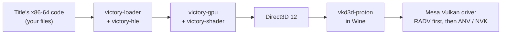

<div align="center">


<br>

[](https://github.com/pablogonz12/Scarlight/actions/workflows/ci.yml)
[](LICENSE)
[](https://github.com/pablogonz12/Scarlight/commits/main)
[](https://github.com/pablogonz12/Scarlight/stargazers)
[](docs/linux.md)
[](https://docs.mesa3d.org/drivers/radv.html)

# Scarlight: the Linux + Mesa port

**The console build on Linux, through open-source Mesa Vulkan drivers (RADV first, then ANV and NVK), Proton's Wine and vkd3d-proton.<br>Mesa is open source, so the driver itself is ours to tune and fix. Early, slow, not playable yet, and measured in the open.**

<sub>[Status](#status) · [Quick start](#quick-start) · [What's different](#whats-different) · [Roadmap](#roadmap) · [Known problems](#known-problems) · [Contribute](#contribute) · [Credits](#credits)</sub>

</div>

Scarlight is a GPL-3.0 port of the console build to **Linux**, running on **open-source Mesa Vulkan
drivers**: RADV (AMD) first, then ANV (Intel) and NVK (NVIDIA). It runs the title's own x86-64 code
from files you supply, answers its console-only calls, and turns its GPU commands and shaders into
Direct3D 12 on top of vkd3d-proton and Wine/Proton. It builds on
[VIctory](https://github.com/Marvisak/VIctory) and
[fxceless's victory-fork](https://github.com/fxceless/victory-fork). The goals, in order: the
**picture**, then **speed**, then **stability**. Because Mesa is open source, the driver is in scope
too: its switches, statistics, pipeline cache, a local Mesa build, and fixes sent upstream. No game
files, dumps or screenshots are here.



## Status

**Tested on one machine so far (25 Nov 2026):** RX 9070 XT (RDNA4) · Mesa 26.3.1 **RADV** · CachyOS
(Arch family), kernel 7.3.6 · GE-Proton11-14 · vkd3d-proton master · 30 GB RAM + zram. All game runs
use diagnostics builds. **Other Mesa GPUs are untested**: older AMD cards on RADV, Intel on ANV and
NVIDIA on NVK are the target, so a report from any of them is worth as much as a patch
([see Contribute](#contribute)).

The builds differ, and **the fastest one measured here is not Scarlight's code yet**:

| Build | World fps | Time to world | Picture and run notes |
|---|---|---|---|
| [JoshuuDev/victory-amd](https://github.com/JoshuuDev/victory-amd) `003beef2`, unmodified (best measured; a base we are evaluating) | **1.20 / 1.33 / 1.85** (3 runs) | 155-160 s (about 2.5 min) | Lit, textured world with walls. A face and some close-up character detail are missing |
| Scarlight [`keep/good-0257-live2`](https://github.com/pablogonz12/Scarlight/tree/keep/good-0257-live2) (**quick start**) | 0.82 / 0.95 (2 runs) | 217 s (run 1) | Faces showed in an earlier play session; run 1 had walls missing |
| Scarlight candidate 3 (local branch, **not pushed yet**) | 1.18 (1 run) | 133 s | Walls and a face missing |

fps is the test runner's per-run figure on an automated route into the world. Counting only
world-frame lines, the three victory-amd runs have medians of 1.3, 1.8 and 2.2 fps: the same binary
varies a lot, so small gains from single runs mean nothing. Camera and run length were not identical.
`main` was not re-measured in this round; its last recorded state is a mostly black world under 1 fps
([AMD-LINUX.md](AMD-LINUX.md)).

**Offline shader translation** (a local set of 751 world programs, not distributed):

| Tree | Translated |
|---|---|
| Scarlight candidate 3 (local) | **751 / 751** |
| [project-flamingo](https://github.com/JMAN730/project-flamingo) `main` `e00a0198` | 679 / 751 |

Translating a program does not prove it draws correctly, or that the driver pipeline is ready in
time. These counts are not for the quick-start tag.

## Quick start

For Arch-family Linux with Mesa. Measured only on an RX 9070 XT with RADV; other Mesa GPUs (older
AMD cards on RADV, Intel on ANV, NVIDIA on NVK) should work and are untested. NVIDIA's proprietary
driver and native Windows are not supported here: see
[project-flamingo](https://github.com/JMAN730/project-flamingo) or
[victory-fork](https://github.com/fxceless/victory-fork). 32 GB of RAM or more is recommended.

**You need:**

- your own legally obtained copy of the title's files, kept outside the repository (none is
  included, linked or shared);
- [GE-Proton11-14](https://github.com/GloriousEggroll/proton-ge-custom/releases);
- 64-bit `d3d12.dll` and `d3d12core.dll` from [vkd3d-proton](https://github.com/HansKristian-Work/vkd3d-proton)
  **master** (stock 3.1 crashed at world entry);
- 64-bit `dxcompiler.dll` and `dxil.dll` from
  [DirectXShaderCompiler](https://github.com/microsoft/DirectXShaderCompiler/releases);
- Microsoft's 64-bit `d3dcompiler_47.dll`, from software you are licensed to use (a stop-gap:
  Wine's built-in one rejects some runtime shaders).

**Build** the tag:

```bash
sudo pacman -S --needed mesa vulkan-radeon rustup git clang lld llvm   # vulkan-intel on Intel, mesa-vulkan-drivers elsewhere
git clone https://github.com/pablogonz12/Scarlight && cd Scarlight
git checkout keep/good-0257-live2
rustup toolchain install                 # version pinned in rust-toolchain.toml
cargo install cargo-xwin                 # once
cargo xwin build --release -p victory --features diagnostics --target x86_64-pc-windows-msvc
```

**Run** it with GE-Proton's `wine` binary (not the `proton` script). Edit the first five paths:

```bash
GE="$HOME/.local/share/Steam/compatibilitytools.d/GE-Proton11-14"  # your folder name
VKD3D="$HOME/dlls/vkd3d-proton-master"   # d3d12.dll, d3d12core.dll (x64)
DXC="$HOME/dlls/dxc"                     # dxcompiler.dll, dxil.dll (x64)
D3DC="$HOME/dlls/d3dcompiler_47.dll"     # x64
GAME="$HOME/victory-data/game/<the title's exe>"
OUT="$PWD/target/x86_64-pc-windows-msvc/release"   # from the Scarlight folder

cp "$VKD3D"/d3d12.dll "$VKD3D"/d3d12core.dll "$DXC"/dxcompiler.dll "$DXC"/dxil.dll "$D3DC" "$OUT"/
cp "$GE"/files/lib/wine/dxvk/x86_64-windows/dxgi.dll "$OUT"/

WINEPREFIX="$HOME/.local/share/scarlight-prefix" \
WINEDLLOVERRIDES="d3d12,d3d12core,dxgi,d3d11,d3d10core,d3dcompiler_47=n,b" \
VKD3D_CONFIG=ignore_shared_fence VICTORY_LOG=info \
"$GE/files/bin/wine" "$OUT/victory.exe" run "$GAME" --execute
```

The tag was built from a clean checkout on 25 Nov. The runs above used the maintainer's test
scripts; this shortened command sequence has not been run as written on a fresh prefix. If it fails,
please [open an issue](https://github.com/pablogonz12/Scarlight/issues/new/choose). A play script,
controls and troubleshooting are in [docs/linux.md](docs/linux.md).

## What's different

| | Scarlight |
|---|---|
| **Built for Linux only** | The title runs on Linux through Wine/Proton and vkd3d-proton. Nothing here keeps a native Windows path working, so every change is measured on the stack people actually run |
| **The driver is ours to fix** | Mesa is open source, so the driver is part of the project: RADV/ACO env and driconf switches, pipeline-executable statistics, a local Mesa build loaded through `VK_ICD_FILENAMES`, and bug reports or patches to Mesa itself. Other ports stop at the Vulkan API |
| **RADV first, then ANV and NVK** | One driver family, several GPUs. RADV is the reference; Intel's ANV and NVIDIA's NVK come next. Driver-specific work is gated by Vulkan driver and device id, so no GPU loses a working path |
| **Picture before speed** | A speed change that costs picture quality is not taken |
| **Many ports, one test box** | We follow the other ports and forks, try their fixes on the same card, and bring in what helps, authors credited |
| **Tests without the game first** | Unit tests and offline shader translation, with a per-program output diff, come before a game run |
| **Honest numbers** | Build, run count and known faults are listed with each figure, including when another tree is ahead |
| **Giving back** | Fixes that apply elsewhere are offered upstream as issues and pull requests |

Other ports worth following, each with its own focus:
[VIctory](https://github.com/Marvisak/VIctory),
[victory-fork](https://github.com/fxceless/victory-fork),
[project-flamingo](https://github.com/JMAN730/project-flamingo),
[VItoriaBr](https://github.com/uiliannn/VItoriaBr),
[victory-amd](https://github.com/JoshuuDev/victory-amd) and
[VIctory-Belobug-AMD](https://github.com/Belobug/VIctory-Belobug-AMD). Their own pages report their
results on their own hardware. The Belobug build we tried here did not get past loading under Wine;
that says nothing about it on Windows.

## Roadmap

| Milestone | Goal |
|---|---|
| **M0 · Unblock** | Newer builds boot reliably; choose one base by close-up picture quality first, speed second |
| **M1 · Picture parity** | On a fixed scene: faces, full-detail characters up close, walls, no black flashes, matching colour |
| **M2 · Frame gaps** | Find where frame time is lost; pipelines ready earlier. Target: about 2.5-3 fps, world in under 90 s |
| **M3 · Memory** | Fewer copies and memory-tracking calls. Target: about 4 fps, no stalls over 1 s |
| **M4 · Overlap + stability** | Prepare the next frame while the GPU draws; one-hour sessions without a crash |

Targets are goals, not results.

**Mesa track, in parallel:** driver env and driconf switches, pipeline-executable statistics, a local
Mesa build for experiments and upstream Mesa reports, each measured like any other change. Nothing
Scarlight ships may require RDNA4; RADV- or ANV-only paths are gated by Vulkan driver id.

## Known problems

- **Not playable.** About 0.8-2 fps in the world, with multi-second stalls.
- **Picture:** on the newest base, a face and some close-up character detail (lowest detail level up
  close) are missing; under investigation. Other builds have missing walls.
- **Shadows:** ray-traced lighting is incomplete, so some interiors and shadowed areas are dark.
- **Intro:** frames can show out of order.
- **Stability:** some builds and runs hang at boot or world entry, or lose the D3D12 device.
  `VICTORY_ASYNC_WRITEBACK=1` is experimental and has hung the title.
- **Branches:** the builds above are not merged into `main`.

## Contribute

**A test report from another Mesa GPU is as useful as a patch**, and the only tested config so far is
RX 9070 XT + RADV: AMD (other RADV generations), Intel (ANV) and NVIDIA (NVK) all welcome — card,
driver and Mesa version, build tag, fps and what looked wrong, in text and logs only (no screenshots
or game data). Pull requests target `main`; see [CONTRIBUTING.md](CONTRIBUTING.md). CI and review come
before merge. Docs, commits and PRs never name the title or its developer, and game files are never
committed ([asset policy](docs/asset-policy.md)). Parts of this project, this page included, are
written with AI coding tools. Crates: [docs/architecture.md](docs/architecture.md).

If you want a **Linux + Mesa** port to keep moving, **star the repository**.

## Credits

- [Marvisak/VIctory](https://github.com/Marvisak/VIctory) (Marvis and contributors): the project this is built on.
- [fxceless/victory-fork](https://github.com/fxceless/victory-fork) (fxceless / hyphennn): the base of the quick-start tag and the candidates.
- [uiliannn/VItoriaBr](https://github.com/uiliannn/VItoriaBr) (uiliannn): shader signature fixes, merged in local candidate 3.
- [JoshuuDev/victory-amd](https://github.com/JoshuuDev/victory-amd) (Joshua Odom), built on
  [myokex/victory-amd](https://github.com/myokex/victory-amd): the best build measured here. Their work, measured unmodified.
- **wbkepler**: snapshot page reuse and indirect buffer work. **wrothgaril**: count-aware indirect clamp and related commits.
- **ErRusso**: runtime HLSL through DXC. **ZazaJr24**: configurable pipeline waits.
  **ruvenesh**: the opt-in watchdog hook (VIctory #454).

Authors of commits carried in our candidate and quick-start builds:
9hvn9yt2vk-netizen, Abdellah K., Advait Palve, AlanQiang0418, alessiodeia, Andrea Casale,
AnoHunted, artor410, BaggyALPHA, Carlos Sant'Anna, cxchhh (cxccxc), Dathinel, Duff, EatCodeSleep2,
Enzo Souza Duarte, errusso, Exorion, fever308, FIocker, fuzeofficial, fxceless, Henrique Bueno,
hophaver, ifBars, ismailchaka1, itsRevela, Jeremy Goldberg, julio, KoLolX3, lameloball2813-ui,
LaunchDoesntCode, localshotgun, lordon1a, Louis Faust, LUIS LARIOS, Luiz Neves,
Luiz Otavio Mello de Campos, Lyrnc, Manuel Pérez, Maraco91, marquezini, Marvis, meower, Nostyxx,
oddiums, pablogonz12 (Pablo Gonzalez), Pedro Fortunato, quaternion, r4tedx (r4.), raffclar,
Saitken91, spacede, tedin7, TG0000, uiliannn, undeadhuman37, Vanthys, wrothgaril, Yaekai, ZazaJr24.
Some commits were also authored by AI coding tools (Claude, Codex). More per-PR credit:
[INTEGRATION.md](INTEGRATION.md). Missing or misnamed? Open an issue.

## License

GPL-3.0-or-later; see [LICENSE](LICENSE).
